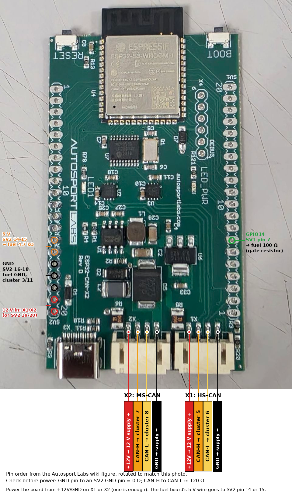
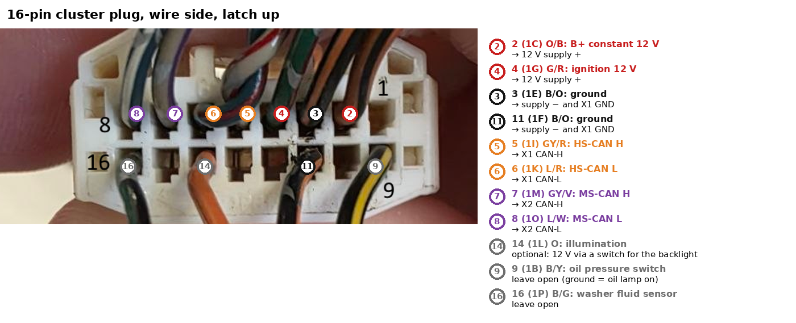
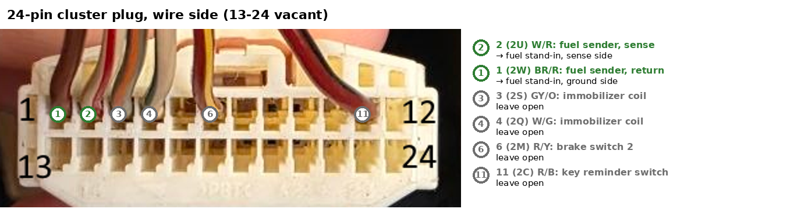
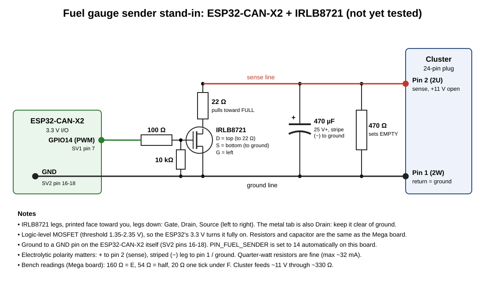
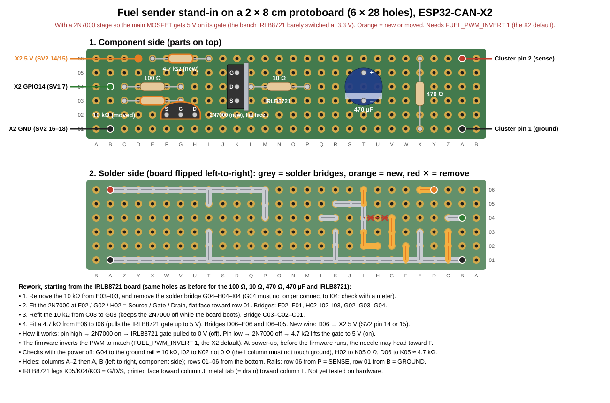

# ATS_ETS_Mazda3_Cluster
Bridging physical and simulation - Connect a physical Mazda 3 instrument cluster and obtain readings from ATS or ETS on the real gauges!

```
American Truck                        Autosport Labs      HS-CAN 500k   2005 Mazda 3
Simulator   ──────► SimHub      ────► ESP32-CAN-X2  ────► MS-CAN 125k ─► instrument
(telemetry)         (USB serial)                                       cluster
```

SimHub reads ATS telemetry and streams it as text over USB serial. The
ESP32-CAN-X2 parses it and continuously sends the CAN frames the cluster would normally get
from the engine computer (PCM) and ABS unit, so the tach, speedo, temperature
gauge, fuel gauge and warning lamps follow the game.

## Repository layout

| Path | What it is |
|---|---|
| `firmware/ATS_Mazda3_Cluster/` | Arduino sketch: open `ATS_Mazda3_Cluster.ino` in the Arduino IDE |
| `firmware/ATS_Mazda3_Cluster/config.h` | Every setting you're likely to change: pins, scaling, timeouts |
| `firmware/ATS_Mazda3_Cluster/mazda3_can.h` | CAN IDs and byte layouts for the cluster |
| `firmware/ATS_Mazda3_Cluster/telemetry_parser.h` | Parser for the serial text SimHub sends |
| `firmware/ATS_Mazda3_Cluster/twai_can.h` | The ESP32's built-in CAN controller (HS-CAN on X1) |
| `tools/cluster_tester.html` | Bench tester: drive the cluster from Chrome or Edge without the game, nothing to install |
| `tools/simhub/Mazda3_Cluster.shsds` | SimHub Custom serial device profile: import it instead of setting SimHub up by hand |
| `test/test_logic.cpp` | Unit tests for the frame encoding and parser (run on a PC) |

## Hardware

- 2004–2009 (BK) Mazda 3 instrument cluster (the 2005 is a BK)
- Autosport Labs [ESP32-CAN-X2](https://wiki.autosportlabs.com/ESP32-CAN-X2)
  (ESP32-S3), which has both CAN buses on one board
- 12 V DC supply, at least 1 A (a bench supply or a 12 V wall adapter)
- A 2–3 A inline fuse for the 12 V feed
- Optional: a 120 Ω resistor, if your cluster turns out not to terminate the
  CAN bus itself (see [Termination](#wiring-the-cluster))
- Parts for the fuel sender stand-in (see [Fuel gauge](#fuel-gauge))

### ESP32-CAN-X2

> **Tested on a real 2005 cluster** (October 2026): both CAN buses, the gauges,
> lamps and the fuel stand-in with the 2N7000 driver stage work on the
> ESP32-CAN-X2.

The [ESP32-CAN-X2](https://wiki.autosportlabs.com/ESP32-CAN-X2) has two CAN channels, each with its own transceiver, one for each of
the cluster's buses.

| Board | Bus | Cluster positions | Notes |
|---|---|---|---|
| **X1** (CAN1, the ESP32's built-in controller, GPIO7 TX / GPIO6 RX) | HS-CAN, 500 kbit/s | 5 (H), 6 (L) | Gauges, check engine, AT, cruise |
| **X2** (CAN2, onboard MCP2515, 16 MHz, CS GPIO10) | MS-CAN, 125 kbit/s | 7 (H), 8 (L) | High beam, turn arrows, SRS, BRAKE (`MS_CAN_ENABLED 1`) |
| **+12 V / GND on X1 (or X2)** | | 2 and 4 supply; 3, 11 | Board power: the same fused 12 V supply as the cluster. SV2 pins 19/20 (12 V in) work too; use one or the other |
| **GND** (SV2 pins 16–18) | | 3, 11 | Common ground with the cluster. The fuel stand-in's GND wire goes here too, not to power ground |
| **GPIO14** (SV1 pin 7) | | | Fuel stand-in driver input (`PIN_FUEL_SENDER`) |
| **5 V** (SV2 pins 14/15) | | | Pull-up for the fuel stand-in's MOSFET gate |

The 4-pin X1/X2 connectors aren't labelled pin by pin. Looking down on the
board with the connectors at the bottom edge (USB-C on the left), each one
reads +12 V, CAN-H, CAN-L, GND from left to right (from the Autosport Labs
pinout figure). Autosport Labs warn that the pigtail colours may not match
their docs, so check with a meter before connecting: about 120 Ω between
CAN-H and CAN-L with the power off, and 0 Ω from GND to an SV2 GND pin.

**Powering the board from X1/X2:** the bench 12 V supply goes into +12 V and
GND on X1 or X2 (tested on the bench board), in place of SV2 pins 19/20.
Autosport Labs label the pin "+12V_AUX, 6–12 V power supply". One connector's
+12 V is enough; if you wire both, use the same supply. The GND pin then also
gives the cluster its common ground with the board. Keep the 12 V behind the
inline fuse.

**Termination:** both channels have 120 Ω on by default (pads TERM1/TERM2 on
the back). Cut a pad only if `#stat` reports errors and you read about 40 Ω
across CAN-H/CAN-L with the power off.

The board's pins are **3.3 V**. Never connect one straight to a cluster input,
which works at 12 V. The fuel stand-in gets a small 2N7000 stage that drives
its MOSFET's gate from the board's 5 V output, because the bench IRLB8721
barely conducted with 3.3 V on its gate (see
[Stand-in parts](#stand-in-parts)).

The USB-C port is the ESP32-S3's own USB serial. It shows up as a COM port, and
SimHub and the tester page in `tools/` talk to it at 115200 baud.

### Board connections

Where each wire goes on the ESP32-CAN-X2: the X1/X2 CAN connectors (with
board power), the fuel stand-in's GPIO14, 5 V and GND wires, and the
alternative 12 V input on SV2.



## Wiring the cluster

The pin numbers below come from the factory wiring diagram for the 2005
Mazda 3 2.3L instrument cluster (diagrams 0922-1a to 0922-1d). The cluster has
two connectors on the back: a 16-pin one (pins `1A`–`1P`) and a 24-pin one
(pins `2A`–`2X`). Wire colours are the car harness side, so they only help if
you cut the plugs from a donor car. Check each pin with a multimeter on your
own cluster before you power it, because other markets and years may differ.

On the 16-pin plug, the "Position" column counts with the plug held as below,
looking at the wire side with the latch up: the top row is 1–8 from right to
left, and the bottom row is 9–16 from right to left. Factory letters run
`1A`, `1C`, … `1O` along the top and `1B`, `1D`, … `1P` along the bottom, and
the wire colours match a 2005 harness plug in this orientation.

```
 top row:     8   7   6   5   4   3   2   1      (1O 1M 1K 1I 1G 1E 1C 1A)
 bottom row: 16  15  14  13  12  11  10   9      (1P 1N 1L 1J 1H 1F 1D 1B)
```



**16-pin plug, every position:**

| Position | Factory pin | Wire | Signal | Bench |
|---|---|---|---|---|
| 1 | `1A` | — | Vacant | — |
| 2 | `1C` | O/B (orange/black) | B+, constant 12 V | 12 V supply + |
| 3 | `1E` | B/O (black/orange) | Ground | 12 V supply − and X1 GND (or an SV2 GND pin) |
| 4 | `1G` | G/R (green/red) | IG1, ignition 12 V | 12 V supply + |
| 5 | `1I` | GY/R (grey/red) | HS-CAN H, 500 kbit/s | X1 CAN-H |
| 6 | `1K` | L/R (blue/red) | HS-CAN L, 500 kbit/s | X1 CAN-L |
| 7 | `1M` | GY/V (grey/violet) | MS-CAN H, 125 kbit/s (body bus): high beam, turn arrows, SRS lamp | X2 CAN-H |
| 8 | `1O` | L/W (blue/white) | MS-CAN L, 125 kbit/s (body bus) | X2 CAN-L |
| 9 | `1B` | B/Y (black/yellow) | Oil pressure switch (grounded = oil lamp on, bench-confirmed) | Leave open |
| 10 | `1D` | — | Vacant | — |
| 11 | `1F` | B/O (black/orange) | Ground | 12 V supply − and X1 GND (or an SV2 GND pin) |
| 12 | `1H` | — | Vacant | — |
| 13 | `1J` | — | Vacant | — |
| 14 | `1L` | O (orange) | Illumination, +12 V with headlights on | Optional: 12 V via a switch for the backlight |
| 15 | `1N` | — | Vacant | — |
| 16 | `1P` | B/G (black/green) | Washer fluid-level sensor (only on cars with one) | Leave open |

Positions 5 and 6 are a twisted pair in the harness, as are 7 and 8. The two
buses run at different speeds, so each has its own channel: X1 on 5/6
(gauges) and X2 on 7/8 (lamps). Without the body bus on 7/8, the high beam,
turn arrows and SRS lamp aren't driven (the SRS lamp stays on).

**24-pin plug, every position.** Counted with the plug held the same way, from
the wire side: the top row is 1–12 from left to right, and the bottom row is
13–24 from left to right. None of these pins are needed on the bench.

```
 top row:     1   2   3   4   5   6   7   8   9  10  11  12   (2W 2U 2S 2Q 2O 2M 2K 2I 2G 2E 2C 2A)
 bottom row: 13  14  15  16  17  18  19  20  21  22  23  24   (2X 2V 2T 2R 2P 2N 2L 2J 2H 2F 2D 2B)
```



| Position | Factory pin | Wire | Signal | Bench |
|---|---|---|---|---|
| 1 | `2W` | BR/R (brown/red) | Fuel gauge sender, one side | Open (the gauge should read empty), or the sender stand-in. See [Fuel gauge](#fuel-gauge) |
| 2 | `2U` | W/R (white/red) | Fuel gauge sender, other side | As above |
| 3 | `2S` | GY/O (grey/orange) | Immobilizer coil antenna | Leave open (the security lamp may blink) |
| 4 | `2Q` | W/G (white/green) | Immobilizer coil antenna | Leave open |
| 5 | `2O` | W (white) | Car navigation unit (only on cars with nav) | Leave open |
| 6 | `2M` | R/Y (red/yellow) | Brake switch 2 (brake pedal) | Leave open |
| 11 | `2C` | R/B (red/black) | Key reminder switch (key in the ignition) | Leave open |
| 7–10, 12–24 | | — | Vacant | — |

**Bench minimum** (this is all the cluster needs to wake up and move needles):

| Cluster pin | Position | Wire | Signal | Connect to |
|---|---|---|---|---|
| `1C` | 2 | O/B | B+ (constant 12 V, ROOM fuse in the car) | 12 V supply + |
| `1G` | 4 | G/R | IG1 (ignition 12 V, METER 10 A fuse in the car) | 12 V supply + (the cluster stays dark without it) |
| `1E` | 3 | B/O | Ground | 12 V supply − **and** board GND |
| `1F` | 11 | B/O | Ground | 12 V supply − **and** board GND |
| `1I` | 5 | GY/R | HS-CAN H (500 kbit/s) | X1 CAN-H |
| `1K` | 6 | L/R | HS-CAN L (500 kbit/s) | X1 CAN-L |

The 12 V supply also feeds the board, through +12 V/GND on X1 (or SV2 pins
19/20).

Fuse the 12 V feed (a 2–3 A inline fuse is plenty for a bench cluster), since
the car has a 10 A and a 15 A fuse on these lines.

All other pins are vacant. In the car, the brake fluid-level and parking brake
switches go to the junction box, not the cluster, which is why the parking
brake lamp comes over CAN (`0x212`).

**Termination:** a CAN bus needs 120 Ω across H and L at each end. The
diagram draws a resistor across HS-CAN H/L (and across MS-CAN H/L) inside the
cluster, so the cluster probably terminates its end already. With everything
unpowered, measure `1I` to `1K` on the bare cluster:

- About **120 Ω**: the cluster is terminated. Don't add a resistor.
- **Open circuit**: add a 120 Ω resistor across `1I` and `1K` at the cluster end.

The ESP32-CAN-X2 terminates the other end on both channels. With both ends
terminated and the power off, you should read about 60 Ω between CAN-H and
CAN-L on X1 (and on X2).

Twist the CAN-H/CAN-L pair, and keep it away from the 12 V supply leads.

## Fuel gauge

The fuel gauge isn't on CAN. The cluster reads the tank sender's resistance
on 24-pin positions 1/2 (`2W`/`2U`): low resistance is full, high is empty.
The 2005 manual on lemon-manuals.la gives no resistance values. On a
bench-tested 2005 cluster, about 160 Ω puts the needle on E, 54 Ω on half,
20 Ω one tick under F and 16.8 Ω right on F (10 Ω goes past F). The needle moves about evenly with the log of the
resistance, not in a straight line, and the firmware follows that curve.

**1. Check the gauge with fixed resistors first** (cluster powered, no game
needed):

- With nothing on positions 1/2, measure the DC voltage across them, and note
  which one reads positive. That's the sense side; the other is the return.
  Also check whether the return has continuity to cluster ground (position 3
  or 11). On a bench-tested 2005 cluster it's about 11 V, with position 2
  positive (sense) and position 1 the return, which is cluster ground. The
  cluster feeds the sender through about 330 Ω: 20 Ω across the pins read
  0.64 V (about 32 mA) and showed a full tank.
- Put a resistor across 1/2 and turn the ignition off and on (the gauge moves
  slowly, and some clusters only jump to a new level at ignition on). Try
  about 22, 47, 100 and 160 Ω, and note where the needle settles each time.
  If yours differs from the values above, change
  `FUEL_SENDER_FULL_OHMS`/`FUEL_SENDER_HALF_OHMS`/`FUEL_SENDER_EMPTY_OHMS` in
  `config.h` to match.
- The cluster's own self-test also sweeps the gauge: hold the trip button,
  turn the ignition on, keep holding about 5 s until `tESt` shows, release
  within 3 s, then press the button to step to check code 23 (fuel gauge).

**2. Sender stand-in.** A fixed resistor sets the empty reading, and a MOSFET
on a PWM pin switches a small resistor in parallel to pull it toward full. A
capacitor smooths the switching, so the cluster sees one steady resistance
between the two. The board is laid out on a double-sided 2 × 8 cm protoboard
(parts on top, solder bridges underneath).

**The GND wire must go to a GND pin on the board itself, not to power ground.**
Even with the board and the 12 V supply sharing ground, the stand-in has
failed twice with its ground on power ground: once the MOSFET only half
switched on and the voltages were wrong, and once the voltages followed
`#ohms` but the needle stayed on half. Both times moving the wire to a GND
pin on the board fixed it. The return side must be at cluster ground (step 1)
for that link to be safe. If it isn't, stop and ask before wiring this up.
The current is small (about 32 mA at most), so quarter-watt resistors are
plenty.

The `F` field (0–100 %) sets the PWM duty. The duty is about 4% at empty
(pulling 470 Ω down to 160 Ω) and fully on near full, and the gauge moves
between the two. With the 10 Ω switched resistor the pair reaches about 10 Ω,
below the 16.8 Ω that reads F. `#ohms N` sets the stand-in to N Ω directly.

### Stand-in parts

Tested on a real 2005 cluster with the 2N7000 driver stage. The board's
3.3 V pins left the bench IRLB8721 barely on, so a 2N7000 drives its gate from
the board's 5 V instead.





| Part | Goes between |
|---|---|
| 470 Ω, 0.25 W | Position 2 (sense) and position 1 (return) |
| 10 Ω, 0.25 W, in series with an IRLB8721 (logic-level N-MOSFET) | Sense side → 10 Ω → drain; source → return side |
| 470 µF, 25 V or more, electrolytic | Sense side (+) and return side (−) |
| 100 Ω | X2 `GPIO14` (SV1 pin 7) → 2N7000 gate |
| 10 kΩ | 2N7000 gate → ground (keeps it off while the board boots) |
| 2N7000 | Source → ground; drain → IRLB8721 gate |
| 4.7 kΩ | IRLB8721 gate → X2 5 V (SV2 pin 14 or 15) |
| Wire | MOSFET source / return side → an SV2 GND pin (16–18) |

`PIN_FUEL_SENDER` is 14 in `config.h` (set -1 without the stand-in), with a
10-bit PWM. The 2N7000 inverts the signal (pin high = IRLB8721 off), so
`FUEL_PWM_INVERT` is 1 by default. Set it to 0 if your MOSFET's gate
is driven straight from the pin. Until the firmware starts, the 4.7 kΩ holds
the IRLB8721 on, so the needle may head toward F at power-up.

### Checking the stand-in

With the cluster powered, measure the DC voltage across positions 2/1. On the
bench cluster, with the gate input unconnected it read 6.6 V (470 Ω, needle
on E). The needle follows the slider
without an ignition cycle, but give it several seconds to settle. When
checking a calibration point, power cycle the cluster and read the needle
then: on the bench, `#ohms 20` looked like F right after other moves but read
one tick under F after a power cycle, while 16.8 Ω landed on F.

## Turn signals and high beam

On this cluster the turn signal and high beam lamps are **not** hard-wired
inputs. The diagram shows them driven by the cluster's own microcomputer,
like the warning lamps. `1K` is HS-CAN L: don't put a transistor or 12 V on
it, because it will take down the CAN bus.

The cluster gets those lamp states over the MS-CAN body bus on `1M`/`1O` (plug
positions 7/8). On a bench-tested 2005 cluster the high beam lamp is body-bus
`0x433` byte 3 = `0x40` (the same bit community RX-8/Mazda decodes list), and
the firmware drives it from the `H` field whenever it can reach the body bus
(`MS_CAN_ENABLED 1`). The turn arrows are body-bus `0x265`
byte 0: `0x20` left, `0x40` right (`0x10` lights the immobilizer lamp). The
cluster holds an arrow solid while its bit is set, so the firmware flashes it
from the `L`/`Y` fields (`TURN_BLINK_HALF_MS`, 333 ms by default). If your game
output already blinks, the lamp follows that timing. There is no separate
hazard bit: hazards are `L` and `Y` on together, and both arrows share one
flasher so they stay in step. Nothing in `0x433` on
HS-CAN lights any of them.

## Firmware setup

1. Install the **Arduino IDE** (2.x).
2. *Library Manager* → install **"CAN-BUS Shield" by Seeed Studio** (v2.x,
   which provides `mcp2515_can.h`, used for the X2's MCP2515). Or install it
   from <https://github.com/Seeed-Studio/Seeed_Arduino_CAN>.
3. *Boards Manager* → install **"esp32" by Espressif** (v3.x).
4. Open `firmware/ATS_Mazda3_Cluster/ATS_Mazda3_Cluster.ino`.
5. *Tools → Board → esp32 → AutosportLabs ESP-CAN-X2*.
6. Review `config.h`, then upload.

On power-up the board sweeps the tach and speedo to full scale and back, which
shows the CAN link works. If the needles don't move, see
[Troubleshooting](#troubleshooting).

## Bench test without the game

Open `tools/cluster_tester.html` in Chrome or Edge (double-click it), press
**Connect** and pick the board's COM port. Sliders and lamp switches drive the
gauges and lamps straight from the browser, a box sends any `#` command, and
the board's replies show in the log. It uses Web Serial, which Firefox and
Safari don't support. Close the Serial Monitor and SimHub first, because only
one program can hold the port at a time.

## SimHub setup

SimHub sends the game telemetry to the board as a Custom serial device.

**Quick setup: import the ready-made profile.** `tools/simhub/Mazda3_Cluster.shsds`
is a Custom serial device profile with everything below already filled in.

1. In SimHub, enable the **Custom serial devices** plugin.
2. Open it and use **Import** to load `Mazda3_Cluster.shsds`.
3. Pick your board's COM port (it's set to COM7) and leave the baud rate at
   115200.

It sends RPM, speed (mph), coolant, throttle, fuel, gear, the battery and oil
lamps, parking brake, turn signals, high beam and cruise. Lamps come from
SimHub's ATS/ETS2 telemetry (`GameRawData.TruckValues.CurrentValues...`), and
the turn signals and parking brake fall back to SimHub's generic properties.
If a lamp never lights, find its property in SimHub's property picker and
correct the name in the profile's JavaScript. The free SimHub version sends
10 updates a second, which is fine: the board keeps the needles at the last
values between updates.

**Or set it up by hand:**

1. In SimHub, enable the **Custom serial devices** plugin, add a device, and
   pick the board's COM port at **115200** baud.
2. Add an **update message** and set it to a computed formula (NCalc):

   ```
   'R' + format([Rpms], '0') +
   'S' + format([SpeedMph], '0.0') +
   'T' + format([WaterTemperature], '0') +
   'A' + format([Throttle], '0') +
   'F' + format([FuelPercent], '0') +
   'E' + if([EngineWarning] > 0, '1', '0') +
   'O' + if([OilPressureWarning] > 0, '1', '0') +
   'P' + if([Handbrake] > 0, '1', '0') +
   'L' + if([TurnIndicatorLeft] > 0, '1', '0') +
   'Y' + if([TurnIndicatorRight] > 0, '1', '0') +
   'H' + if([HighBeam] > 0, '1', '0') +
   'G' + if([Gear] == 'R', '-1', if([Gear] == 'N', '0', if([Gear] == 'P', '99', [Gear]))) +
   ';'
   ```

   Check the preview in SimHub's formula editor while ATS is running. It should
   show something like `R1450S72.0T88A35F64E0O0P0L1Y0H0G1;`. A property that
   comes through as `True`/`False` or that SimHub doesn't know will show up
   there. Fix it before sending, because stray letters are read as field keys.
3. Set the update rate to 30–60 Hz.

For the cruise lamps, add a `C` field before the final `';'`: `'C' + if(<cruise on>, '2', '0') +`.
Use the cruise control property from SimHub's property picker (search for
"cruise"). `2` lights CRUISE and CRUISE MAIN. Use `1` for MAIN only.

SimHub's `[SpeedMph]` is mph, which matches the default `SPEED_SCALE`. If you
send `[SpeedKmh]` instead, set `SPEED_SCALE 1.0`.

### Serial protocol

Each field is an upper-case letter followed by a number, for example
`R2350S88.5T90A42F75E0B0O0L1Y0H0P0;`. Fields can be in any order, and separators
(`;`, `,`, spaces, newlines) are optional between fields. End each packet with
`;` or a newline so the last field is applied immediately.

| Field | Meaning | Default unit |
|---|---|---|
| `R` | Engine RPM | rpm |
| `S` | Vehicle speed | mph |
| `T` | Coolant temperature | °C |
| `A` | Throttle / accelerator | % |
| `F` | Fuel level | % (0 empty, 100 full). Needs the sender stand-in on 24-pin positions 1/2 and `PIN_FUEL_SENDER` set; see [Fuel gauge](#fuel-gauge) |
| `E` | Check-engine lamp | 0/1, or `2` to flash it |
| `B` | Battery/charge lamp | 0/1 |
| `O` | Oil pressure lamp | 0/1. Not on CAN: needs `PIN_OIL_LAMP` and a transistor on position 9 (see `config.h`) |
| `L` | Left turn signal | 0/1 (body-bus CAN, flashed by the firmware; see [Turn signals and high beam](#turn-signals-and-high-beam)) |
| `Y` | Right turn signal | 0/1 (body-bus CAN, as above) |
| `H` | High beam | 0/1 (body-bus CAN; needs `MS_CAN_ENABLED 1`) |
| `G` | Gear | negative = R, 0 = N, positive = forward gear, `99` = P. Forward gears show as D with the gear number 1–6 (above 6 shows 6), or as plain D with `GEAR_SHOW_NUMBER 0`. `GEAR_MANUAL_LAMP 1` shows M instead of D. Shows P while the game is paused or closed, and nothing if `G` is never sent |
| `P` | Parking brake | 0/1 |
| `C` | Cruise control | 0 off, 1 = switched on (CRUISE MAIN), 2 = engaged (CRUISE and CRUISE MAIN) |

### Scaling

Every value goes through `physical = raw × SCALE + OFFSET` (in `config.h`)
before it reaches the cluster:

- **Speed units**: speed is expected in mph, and the default
  `SPEED_SCALE 1.609344` converts it to the km/h the cluster takes on CAN (a
  US cluster converts back to mph on the dial). If your speed arrives in
  km/h, set `SPEED_SCALE 1.0`. If it arrives in m/s, use `3.6`.
- **Truck RPM on a car tach**: `RPM_DISPLAY_MULTIPLIER` defaults to `1.0`, so
  the tach shows the true reading. A truck redlines around 2,500 rpm, which
  barely moves the cluster's 8,000 rpm needle. Set it to `3.0` to stretch the truck's
  range across the dial.
- **Fuel in litres or gallons**: the cluster wants a percentage. If SimHub
  gives the amount in the tank, set `FUEL_SCALE` to `100 / tank capacity`.

## What's mapped so far

Everything below was found on a 2005 (BK) cluster on the bench. HS-CAN is the
gauge bus (500 kbit/s, positions 5/6, X1). MS-CAN is the body bus
(125 kbit/s, positions 7/8, X2). "Wired" means a plain wire on
the cluster plug, not CAN.

| Gauge or lamp | Bus | Address (CAN ID), byte = value, or pin | Status |
|---|---|---|---|
| Speedometer | HS-CAN | `0x201` bytes 4–5 | Working |
| Tachometer | HS-CAN | `0x201` bytes 0–1 | Working |
| Coolant temperature | HS-CAN | `0x420` byte 0 | Working |
| Battery (charge) lamp | HS-CAN | `0x420` byte 4 = `0x02` | Working |
| Check-engine lamp, steady / flashing | HS-CAN | `0x420` byte 4 = `0x40` / `0x80` | Working |
| Gear display P/R/N/D | HS-CAN | `0x228` byte 0 | Working |
| Gear display 1–6 | HS-CAN | `0x228` byte 0 = `0x14`–`0x64` | Confirmed |
| Manual-mode lamp ("M" indicator) | HS-CAN | `0x228` byte 1 = `0x80` | Confirmed. Shows M in place of D with gears 1–6; off by default (`GEAR_MANUAL_LAMP 1` turns it on). `0x40`–`0x79` light the AT lamp instead |
| AT warning lamp | HS-CAN | `0x228` (any) | On by default; sending the frame turns it off |
| ABS lamp | HS-CAN | `0x212` byte 4 = `0xFF` flashes it | Found, not used |
| Traction control lamp | HS-CAN | `0x250`–`0x25F` | Found, but latches until power-off, so never sent |
| Cruise lamps, CRUISE MAIN / CRUISE | HS-CAN | `0x4EA` byte 0 = `0x80` / `0x40` | Bits confirmed; driven by the `C` field |
| High beam indicator | MS-CAN | `0x433` byte 3 = `0x40` | Working |
| Turn arrows, left / right | MS-CAN | `0x265` byte 0 = `0x20` / `0x40` | Working (firmware flashes them); hazards = both |
| Immobilizer (security) lamp | MS-CAN | `0x265` byte 0 = `0x10` | Found, not used |
| SRS airbag lamp | MS-CAN | `0x460` | On by default; sending the frame turns it off |
| Seat belt chime (off) | MS-CAN | `0x460` byte 1 = `0xFF` | With byte 1 = `0x00` the seat belt lamp flashes and chimes about once a minute |
| Fuel gauge | Wired | 24-pin positions 1/2 (sender resistance) | Complete and tested with the PWM stand-in. With the 10 Ω switched resistor, 100 % (16.8 Ω) lands on F after a power cycle |
| Oil pressure lamp | Wired | 16-pin position 9 to ground | Confirmed; not driven (no game signal) |
| BRAKE (parking brake) lamp | HS-CAN | `0x212` byte 4 = `0x40` | Confirmed, but only with the body bus (MS-CAN) connected; without it the lamp stays on |
| Trip meter / odometer | HS-CAN | `0x420` byte 1 counts up with distance | About 1/8085 mile per count (`ODO_MILES_PER_COUNT`). Confirmed on a 2005 cluster: 5 minutes at 60 mph reads 5.0 miles. Also adds to the odometer. The cluster reports its odometer on MS `0x4FA` in 1/16 mile steps |

## Known limitations

See [What's mapped so far](#whats-mapped-so-far) for everything that works.

- **BRAKE (parking brake) lamp:** needs the body bus (MS-CAN) connected. With it connected, the `P` field (HS `0x212` byte 4 = `0x40`)
  turns the lamp on and off. Without it, the lamp stays on all the time.
- **Fuel gauge:** complete and tested, but not on CAN. It needs the sender
  stand-in circuit on 24-pin positions 1/2 (see [Fuel gauge](#fuel-gauge)).
- **Turn arrows, high beam and SRS lamp:** need the body bus (MS-CAN)
  connected. Without it, they aren't driven and the SRS lamp stays on.
- **Trip meter and odometer:** driven by the `0x420` byte 1 counter, so game
  distance adds to the cluster's real odometer as well as the trip. Set
  `ODO_MILES_PER_COUNT` to 0 to turn it off.
- **Gear display:** P, R, N, D and gears 1–6 work, shown as D plus the gear
  number. The display stops at 6, so higher truck gears show 6. Set
  `GEAR_SHOW_NUMBER 0` for plain D, or `GEAR_MANUAL_LAMP 1` for M instead
  of D.
- **Oil pressure lamp:** a wired switch (16-pin position 9), not CAN. ATS has no
  oil-pressure warning, so it's left unused (`PIN_OIL_LAMP` can drive it).
- **ABS and traction control lamps:** found (HS `0x212` byte 4 = `FF` flashes
  ABS; `0x250`–`0x25F` lights TCS) but not driven. Never send `0x250`–`0x25F`:
  the TCS lamp latches on until the cluster is powered off.
- **Immobilizer lamp:** found (MS `0x265` byte 0 = `0x10`) but not driven.

## Troubleshooting

| Symptom | Check |
|---|---|
| `CAN init failed` repeats in the Serial Monitor | The wrong board selected in *Tools → Board* (it must be AutosportLabs ESP-CAN-X2), or `CAN_TX_PIN`/`CAN_RX_PIN` changed from 7/6 |
| Cluster dark | No 12 V on IG1 (`1G`) or B+ (`1C`), or no ground on `1E`/`1F` |
| Cluster lights up but needles don't move during the boot sweep | CAN-H/L swapped (`1I` is H, `1K` is L), missing termination (aim for ~60 Ω across H/L with power off), or no common ground between the board and the 12 V supply |
| Needles work with the tester page but not in game | Wrong COM port or baud in SimHub, two programs holding the port, or the output string doesn't end with `;` |
| Speed reads about 1.6× too high or too low | `SPEED_SCALE` doesn't match your units: `1.609344` for mph (default), `1.0` for km/h, `3.6` for m/s |
| Tach barely moves | Raise `RPM_DISPLAY_MULTIPLIER` |
| Tach or speedo reads a fixed ratio off | Adjust `RPM_CAN_FACTOR` or `SPEED_CAN_FACTOR` in `mazda3_can.h` |
